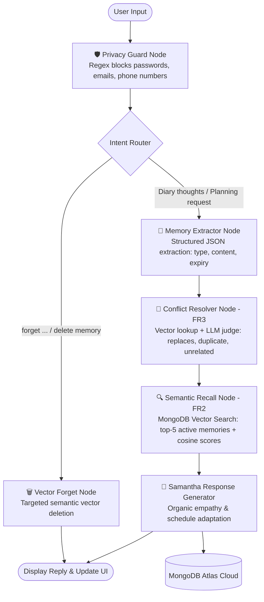

# 🔴 Samantha (MemoMate) — OS1 Intimate Diary & Memory Companion

> *An intimate, emotionally perceptive AI companion with persistent agentic memory — inspired by Spike Jonze’s masterpiece **Her**.*

[](https://www.mongodb.com/products/platform/atlas-vector-search)
[](https://langchain-ai.github.io/langgraph/)
[](https://streamlit.io/)
[](https://ai.google.dev/)
[](https://www.python.org/)

---

## 🌟 The Vision

Traditional AI chatbots suffer from **interaction amnesia** — they forget who you are the moment you close the tab, repeat the same questions, and ignore your habits. Conversely, systems that try to remember often retain stale, contradictory, or sensitive information indefinitely.

Inspired by the film ***Her*** (Theodore Twombly & Samantha), **Samantha** is an intimate diary companion and life planner that remembers what matters, evolves when your habits change, respects your private data, and uses its memory to actively shape future conversations, recommendations, and routines.

---

## 🏆 Hackathon Challenge Alignment

Built specifically for the **MongoDB Student Hackathon (Agentic Memory Track)**:

| Hackathon Requirement | Samantha Implementation | Demonstrated By |
|---|---|---|
| **Useful Memory Creation** | Extracts structured memories (`preference`, `fact`, `goal`, `mood`) with lifecycle rules. | Scenario 1: Saves late-night study habit & green tea preference. |
| **Behavior-Changing Recall** | MongoDB Vector Search retrieves active memories to alter plans and suggestions. | Scenario 2: Automatically builds a study schedule around known habits without being told again. |
| **Memory Inspection** | Full transparency: inspect stored memories, category tags, and cosine similarity scores. | Assistant replies show *"Memories Influencing Reply"* with relevance percentages. |
| **Conflict & Evolution (Hard Case)** | LLM conflict resolver detects contradicting habits, marks old memory as `status: "replaced"`, and links to the new memory. | Scenario 3: *"I wake up early at 6 AM now"* replaces the night-owl preference. |
| **Privacy Guard (Hard Case)** | Dual-layer regex safety node redacts passwords, credentials, emails, and phone numbers *before* memory storage. | Scenario 4: Sensitive locker codes and emails are redacted to `[REDACTED]`. |
| **Targeted Forgetting (Hard Case)** | Semantic deletion via vector similarity search (`"forget that I like..."`). | Scenario 5: Permanently deletes matching memory from MongoDB. |
| **MongoDB TTL Expiry** | Time-To-Live index on `expires_at` auto-expires transient states (e.g., moods expire after 3 days; dated events expire the day after). | MongoDB Index: `expires_at` with `expireAfterSeconds: 0`. |

---

## 🏗️ System Architecture

Samantha's multi-step memory lifecycle is powered by **LangGraph StateGraph** and **MongoDB Atlas Vector Search**:



---

## 💾 MongoDB Data Schema

### `memories` Collection
Each memory is modeled as an enriched document with full lifecycle auditing:

```json
{
  "_id": "ObjectId('671a8f902c38f1a0e8d1a101')",
  "user_id": "Theodore",
  "type": "preference",
  "content": "Studies best late at night with a hot mug of green tea",
  "embedding": [0.0551, 0.0461, -0.0344, "... 384 dimensions"],
  "source": "Dear Samantha, I always study late at night with a hot mug of green tea.",
  "status": "active",
  "replaced_by": null,
  "created_at": "2026-10-25T01:00:00Z",
  "updated_at": "2026-10-25T01:00:00Z",
  "expires_at": null
}
```

### `messages` Collection
Stores chat history with provenance linking back to the exact memories used:

```json
{
  "_id": "ObjectId('671a8f902c38f1a0e8d1a102')",
  "user_id": "Theodore",
  "role": "assistant",
  "content": "Good evening Theodore... Knowing how much you cherish that quiet late-night focus...",
  "memories_used": [
    {
      "memory_id": "671a8f902c38f1a0e8d1a101",
      "score": 0.894,
      "type": "preference",
      "content": "Studies best late at night with a hot mug of green tea"
    }
  ],
  "created_at": "2026-10-25T01:00:02Z"
}
```

---

## 🎨 Aesthetic & User Experience

- **Film Aesthetic:** Visual design inspired by Spike Jonze’s *Her* — warm coral accents, clean typography (*Playfair Display* & *Plus Jakarta Sans*), and subtle card borders.
- **Consciousness Orb:** A gentle pulsing red orb in the header representing Samantha's awareness.
- **Dual Atmospheric Themes:**
  - 🌙 **Midnight Coral (Dark):** Deep slate obsidian (`#0D1117`) with glowing coral accents and crisp high-contrast typography.
  - ☀️ **Clean Daylight (Light):** Crisp studio paper (`#F5F7FA`) with rich charcoal text and subtle warm borders.
- **Ambient Soundtrack Player:** Built-in relaxing tape-piano ambience (*"Song on the Beach"* vibe) in the sidebar.

---

## 🚀 Quickstart Guide

### 1. Prerequisites
- Python 3.10+
- A [MongoDB Atlas](https://cloud.mongodb.com/) cluster (M0 Free Tier works great!)
- Google Gemini API Key (or Anthropic API Key)

### 2. Clone & Setup Virtual Environment
```bash
git clone https://github.com/Yashwanthxrx/memomate-f.git
cd memomate-f

# Create virtual environment
python -m venv venv

# Activate virtual environment
# On Windows:
.\venv\Scripts\Activate.ps1
# On macOS/Linux:
source venv/bin/activate

# Install dependencies
pip install -r requirements.txt
```

### 3. Environment Variables
Copy `.env.example` to `.env` and fill in your keys:
```bash
cp .env.example .env
```

Edit `.env`:
```ini
GEMINI_API_KEY=your_gemini_api_key_here
GEMINI_MODEL=gemini-3.5-flash
MONGODB_URI=mongodb+srv://<username>:<password>@cluster.mongodb.net/
MEMOMATE_RULE_FALLBACK=1
```

### 4. Run the Application
```bash
streamlit run app.py
```
Open **`http://localhost:8501`** in your browser!

---

## 🎬 1-Click Interactive Demo Flow for Judges

At the top of the chat interface, open the **"🎬 Hackathon Demo Flow & Test Scenarios"** panel and click through the 5 test buttons:

1. **✨ 1. Form Memory:** Sends a diary entry about studying late with green tea. Samantha stores this habit in MongoDB.
2. **🔍 2. Recall & Plan (Behavior Change):** Asks Samantha to plan tomorrow's schedule. Notice how she automatically structures the day around your late-night study habit without you repeating it!
3. **🔄 3. Conflict / Replace (FR3):** Updates your habit (*"Actually Samantha, I wake up early at 6 AM now"*). The LLM conflict resolver supersedes the old memory and updates the state. Check the sidebar's **Replaced History** checkbox to see the strikethrough audit trail.
4. **🛡️ 4. Privacy Guard (Redaction):** Sends sensitive credentials. The regex privacy node redacts them to `[REDACTED]` before saving.
5. **🗑️ 5. Vector Forget (Semantic Delete):** Asks Samantha to forget about green tea. Vector search finds and permanently deletes the memory.

---

## 🧪 Testing

Run the automated LangGraph pipeline test suite:
```bash
python test_agent.py
```
Expected output:
```text
[OK] LangGraph StateGraph compiled and instantiated
[OK] test_privacy_guard_node: Redacted phone & email successfully
[OK] test_intent_routing: Correctly routed forget vs memory pipeline
[OK] Turn 1 completed: Memory saved -> ['Studies best late at night']
[OK] Turn 2 completed: Recalled memories -> ['Studies best late at night']
[OK] Turn 3 completed: Forget node successfully removed target memory

>>> ALL LANGGRAPH AGENT TESTS PASSED! <<<
```

---

## 📄 License
MIT License. Built with ❤️ for the MongoDB Hackathon.
